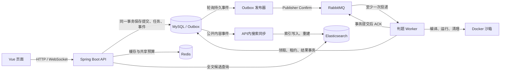
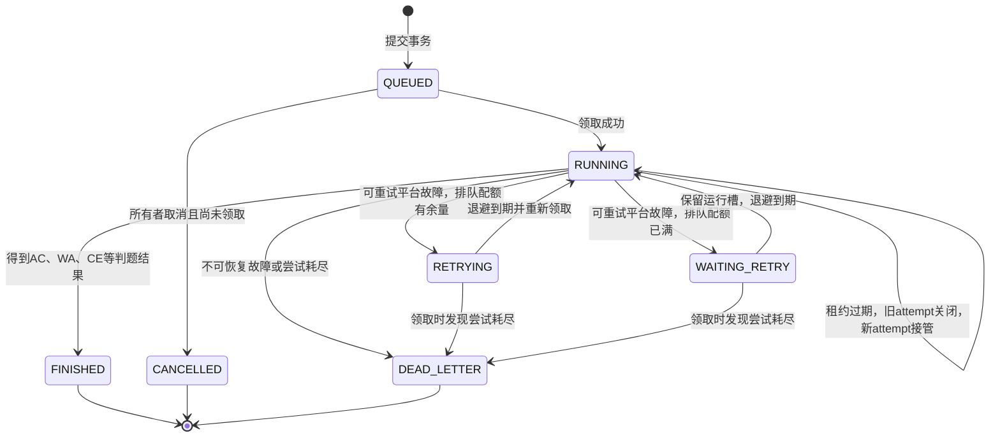

# ForgeOJ：五分钟设计导读

ForgeOJ让Java学习者从题库选题、保存草稿、自测并提交代码，异步取得判题结果与个人进度，也支持小班作业。当前支持Java 21单文件Main和标准输入输出。设计重点是任务可追溯、失败可恢复、私有数据有边界。

## 一次提交经过哪里

图中的发布器与搜索同步是API进程内的后台组件；API与Worker是两个独立应用。

1. API验证账号、题目可见性和配额，以用户与请求标识实现提交幂等；同一事务保存提交、判题版本快照、任务和Outbox事件。响应丢失后用原标识与原源码核对，避免无意创建另一条提交。
2. 发布器得到RabbitMQ确认后记录投递状态。数据库与MQ之间没有共同事务，所以允许重复投递，靠消费者幂等处理。失败意图保留，重试有上限。
3. Worker用数据库条件更新领取任务，创建带lease token的attempt；心跳延长租约。旧Worker失去所有权后，即使继续运行，也不能提交覆盖新attempt的结果。
4. 每次attempt新建沙箱，传入冻结源码，编译一次，逐用例执行，最后清理。沙箱禁网、只读根文件系统、限制CPU/内存/PID/输出；这仍是受控场景的普通Docker隔离，不宣称专业强敌对多租户隔离。
5. Worker先提交结果再ACK。页面通过通知及时得知变化，也用GET轮询兜底；数据库始终是状态事实源。

Redis、MQ、ES均不能代替MySQL判断权限、当前判题版本或最终成绩。ES只索引公开题白名单，使用JDK HttpClient访问REST API，无额外ES客户端Maven依赖；候选结果经MySQL复核，故障时退回标题搜索，响应明确区分FULL_TEXT与TITLE_FALLBACK。源码、隐藏测试和个人学习信息不进入搜索索引。

## 判题任务状态机

以下是内部`judge_task.task_status`，不是一组可直接混用的前端状态：

`FINISHED`表示得到正常判题结论，CE/WA也是结论，不因答案错误重试。内部`WAITING_RETRY`保留该用户运行槽，对外提交仍显示`RUNNING`，防止“1运行+3排队”退避时变成4排队；`DEAD_LETTER`对外对应`SYSTEM_ERROR`。所有者只能取消尚未领取的任务；异常恢复采用有限尝试，不无限循环。

## 故障时会发生什么

| 场景 | 系统如何处理 | 不能省略的约束 |
| --- | --- | --- |
| Worker崩溃或丢失租约 | 到期后恢复扫描/消息重投触发接管，关闭旧attempt并创建新attempt；耗尽转死信 | 旧lease token不能写回；清理只处理已关闭且归属明确的沙箱 |
| 同一消息重复到达 | 按任务状态、版本和租约条件领取；终态重复消息不重复执行有效业务写入 | ACK不代表网络恰好投递一次，也不以Redis锁作为最终幂等依据 |
| RabbitMQ宕机或确认丢失 | 提交与Outbox仍在MySQL；发布器有限重试，确认丢失可重复投递 | 耗尽后保留失败/死信事实，使用受审计恢复，不默默丢弃或承诺无限自动恢复 |
| Elasticsearch宕机、索引落后或不一致 | 关闭本次全文结果，回退MySQL标题查询并给出降级提示；同步/重建恢复索引 | 不能返回旧题、私有题、未经复核的计数或高亮 |

核心代码入口：[提交事务](forgeoj-api/src/main/java/com/forgeoj/api/submission/SubmissionTransactionService.java)、[任务领取](forgeoj-judge-worker/src/main/java/com/forgeoj/worker/task/JudgeTaskClaimService.java)、[完成与退避](forgeoj-judge-worker/src/main/java/com/forgeoj/worker/task/JudgeTaskCompletionService.java)、[沙箱生命周期](forgeoj-judge-worker/src/main/java/com/forgeoj/worker/sandbox/DockerCliSandboxRuntime.java)、[搜索复核与降级](forgeoj-api/src/main/java/com/forgeoj/api/search/PublicSearchService.java)。

复现命令与本机性能数据见[性能导读](PERFORMANCE.md)；验收边界见[当前状态](docs/CURRENT-STATUS.md)。公网演示尚未部署，原本地环境的启停方法见[README](README.md)。
