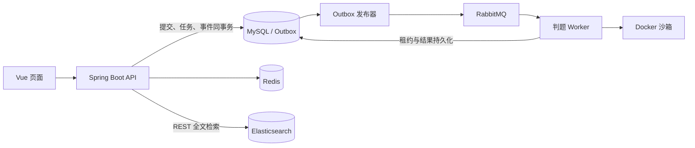

# ForgeOJ

面向 Java 学习者和小型教学班级的在线判题平台。支持 Java 21、单文件 `Main.java` 和标准输入输出题。

**本地演示：** http://127.0.0.1:8088/problems · **账号：** `learner` / `forgeoj-dev-only`。需要先启动本机环境；公网演示尚未部署。

## 能做什么

- 练习：题库、官方题解、可调分栏编辑器、草稿、自测、提交历史和个人进度。
- 教学：原创题目、审核发布、班级和作业；本地演示已有 21 道题。
- 判题：异步执行、资源限制、任务幂等、租约恢复和有限重试。

## 本地运行

安装并启动 Docker Desktop，在已初始化的演示环境中双击 `打开ForgeOJ.cmd`，或在 PowerShell 7 中执行：

```powershell
.\ForgeOJ.ps1 -Action Start
.\ForgeOJ.ps1 -Action Status
.\ForgeOJ.ps1 -Action Stop
```

启动成功后访问上方地址。停止会保留题目、草稿和提交记录。首次安装和环境准备见[本地说明](docs/LOCAL-DEMO.md)。

## 项目结构



API 与 Worker 是两个独立进程。MySQL 保存业务事实，Redis 提供缓存与共享预算，Elasticsearch 提供公开题全文搜索；ES 通过 JDK HttpClient 接入，结果经 MySQL 复核。详见[五分钟设计导读](DESIGN.md)。

## 性能与开发

本机固定 A+B／3 用例负载下，单 Worker 三轮完成约 **17.43～17.69 份/分钟**；顺序提交的结果延迟 P95 约 **4.11 秒**。环境、排队时间、原始数据及复现脚本见[性能报告](PERFORMANCE.md)。

开发命令和 Java 格式约定见[CONTRIBUTING](CONTRIBUTING.md)。项目源码在 `main`，历史预览版本可从仓库标签查看。

[文档导航](docs/README.md) · [面试与设计取舍](docs/ForgeOJ-Interview-QA.md) · [部署说明](deploy/production/README.md) · [历史归档](docs/archive/README.md)

自有代码采用 [Apache-2.0](LICENSE)，第三方来源见 [THIRD_PARTY_NOTICES](THIRD_PARTY_NOTICES.md)。
