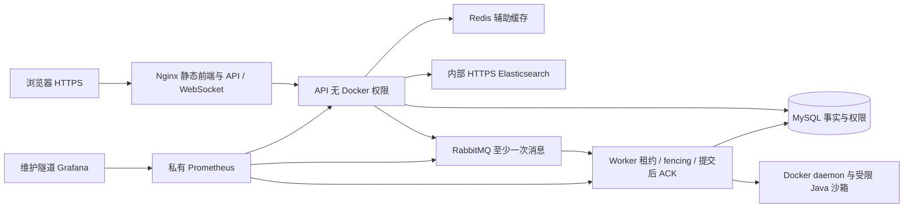

# M5 设计与独立部署包

2026-10-11，用户明确“继续先做设计和独立部署包”。本单元在既有 `feat/m2-accounts` 上实施，不修改已验收业务规则，不创建 PR/main/tag/Release。M5 **IN_PROGRESS**，本包的验证范围见 [验收记录](M5-DEPLOYMENT-VALIDATION.md)。真实 Linux、域名/DNS、生产 SMTP、异地备份和真实试用尚未提供。ES/Grafana 许可沿用 D-047/D-048，不重新询问或切换服务。

## 1. 拓扑与信任边界

业务只由 Nginx 的 80/443 发布；默认绑定 loopback，操作者完成证书、冒烟、维护访问与主机防火墙后才能改公网监听。MySQL/RabbitMQ/Redis/ES/指标不发布宿主端口。Grafana 只绑定 127.0.0.1:3000，经 SSH 本地转发访问；SSH 是维护通道，不擅自关闭或混入业务端口限制。

API 只信任独立内部 ingress 的 Nginx 转发，Nginx覆盖 Host、X-Forwarded-Host/Proto/Port/For 并删除客户端 Forwarded；Origin 原样保留、精确校验和 CSRF 保持、生产 Cookie Secure 默认不关闭。可信范围包括主机维护者与内部基础设施；容器被攻陷后的横向风险不等于零。禁止直接发布 API 8080 或把它接入不受信任共享 Docker 网络。

Worker 的 socket 权限等价于控制整个 daemon，非 root UID/cap_drop 不能消除它。单主机只能服务受控小规模用户；普通 Docker 不保证任意恶意公网源码隔离。宿主须专用、无无关敏感工作负载；将来扩大开放范围需要更强沙箱/独立判题主机设计，不能靠本包声明安全。

## 2. 资源与主机条件

目标 linux/amd64，JDK21，Docker Engine/Compose、cgroup v2、seccomp、CPU/内存/PID 限制有效；支持固定 Java 判题镜像。初始规划按 4 vCPU / 8 GiB / 80 GiB SSD 做容量检查，预留至少 2 GiB 给宿主与沙箱；这不是采购要求、最低性能承诺或压测结论。具体预算/地区/主机确认后再校准。ES 主机 vm.max_map_count、磁盘水位与 Docker 的防火墙行为应按官方部署要求现场核验；不在用户开发机自动改 sysctl/防火墙。

依赖容器上限约 4.5 GiB，Worker 执行沙箱还需要额外资源。单 Worker、prefetch1、现有每用户 1 RUNNING + 3 pending 保持；不为了上线放宽配额、lease、fencing、人工恢复终身额度或 ACK 边界。

## 3. 构件与配置契约

包由严格匹配当前 428 业务/测试/前端输入的既有固定 Linux 构件生成。本次不修改 Maven/Java/Vue 业务源码，所以不重复全量编译。API 镜像展开输入 JAR，仅保留 classes/lib 并明确移除 `db/devdata` 和 `application-dev.properties`；实际启动 classpath 及镜像 ID 独立记录，不能称镜像与输入 JAR 字节相同。Worker 保留原固定 JAR，前端用已构建静态目录，不带源码/Vite/npm安装。镜像只由包内 artifacts/scripts/nginx/notices 构建，仓库和私密目录不能进入 Docker build context。

镜像固定：已批准的 MySQL8.4.12/RabbitMQ4.3.6/Redis7.2.16/ES9.5.3/Prometheus3.15.0/Grafana13.2.3、Temurin21.0.12_8和DockerCLI29.8.0；本单元新增官方 Nginx1.30.5-trixie（BSD2，标准独立代理）。各 FROM/Compose 为实际摘要；应用构建后填 sha256 image ID 或仓库@digest，拒绝浮动 tag。版本/镜像摘要固定不等于完成当前漏洞和完整发行物 SBOM 审计。

非密配置在包外 instance.env：项目名、域名、端口/监听、应用镜像、私密根、Docker socket实际 GID、SMTP主机/地址。生成随机独立 256 位根/迁移/API/Worker DB 密码、普通/管理 JWT、Rabbit/Redis/ES/监控/Grafana秘密。只有适用服务得到对应 file secrets；API 不得到迁移/DB root/ES admin 密钥，Worker 不得到账号JWT/Redis/ES/SMTP密钥。

Spring Boot `configtree:/run/secrets/` 读取属性文件，不将秘密放入 Compose环境、镜像参数或Git。Compose file secrets 是只读 bind mount，并非 Swarm 加密秘管；父目录0700、服务可读叶子文件0444，uid/gid不能靠 Compose file secret 属性重映射。宿主 root/Docker 操作者仍可读取，备份密钥保管需另有安排。[Docker官方说明](https://docs.docker.com/compose/how-tos/use-secrets/)，[Spring配置文档](https://docs.spring.io/spring-boot/reference/features/external-config.html)。

入口正式证书来自用户控制的域名/DNS与CA；本包不代购/自动申请，不内置自签生产证书。ES独立私有证书有效期一年，SAN=search/localhost；API仅获公钥 truststore（固定 changeit 不保护私钥）。入口续期后 `nginx -t`、reload 和 HTTPS冒烟；内部证书续期必须保留旧链过渡并重建信任再滚动服务，不能直接覆盖造成停机。实际续期/过期告警由主机运维阶段验证。

## 4. 安装、升级和权限

MySQL init 仅创建三种数据库身份；V1～V24 Flyway versioned迁移安装/升级，禁用 dev、baseline/repair/clean 和 dev种子。迁移器拥有 schema内迁移与grant权，离线维护容器独立使用，API运行禁用Flyway。启动顺序：基础设施健康→单次迁移成功→ES最小角色配置→API→Worker/Nginx/持久监控；任一步失败停止推进。迁移前拒绝存在运行中的该实例API/Worker/Web，真实升级需先进入维护窗、停止新写、观察在途任务及租约/消息再显式停止准确服务；不强制改判定或清队列。

没有默认普通账号、题目或管理员。首个SUPER用已有交互 `admin-bootstrap`，明确确认数据库、隐藏输入并首次改密；重复 bootstrap拒绝。普通账号用SMTP激活，受控题目通过既有出题/验证/审核，不直接SQL制造AC/公开身份。

Prometheus/Grafana/MySQL/Rabbit/ES使用命名卷。Redis是可丢辅助缓存，关闭落盘仍维持MySQL权限、原幂等和各实例故障保守预算。监控28日/2GB预算，结构化日志local驱动每容器3×10MB，脱敏有限信息；不当作可靠审计，审计在MySQL。磁盘容量/重启持久化/告警实测归后续主机单元。

## 5. 备份、恢复、回滚设计

本包包含配置和操作边界；加密/异地/恢复脚本与实测属于M5后续单元，不宣称已经实现。主机外目的地、访问凭据和离线密钥未定，不能以服务器同盘目录或本地Docker卷冒充异地。

每日一致性MySQL逻辑备份保留全部业务/权限/会话/Outbox/审计及Flyway历史，记录schema/version/source/imageID/UTC时间/摘要。优先规划公钥加密：在线主机只持加密公钥，解密私钥由用户离线保存且有单独恢复副本；最终加密工具/格式在后续实施前核许可与可用性。成功加密且远端完整性确认后才算每日成功，至少7日+4周，不因当日上传失败删除最近有效副本。Rabbit未ACK/死信与在途任务需单独记录，不能将DB dump说成整个系统同时快照。

恢复必须到新项目/新数据库，先校验解密/摘要/Flyway/最小grants，再核用户/班级/提交/任务/attempt/配额/审计/Outbox计数与关键关系；控制Worker启动以防重放，先确认与现存Rabbit去重/原事件边界。运行隔离业务权限和幂等冒烟后才申请实际切换，不覆盖原库。需定义切换时会话撤销与已发送邮件令牌风险。

镜像回滚只切换两个明确兼容版本的API/Worker/Web ID；不自动downgrade schema、不清队列、不还原源码/判定。发布前保留前版包与兼容矩阵；旧版不理解新schema/消息时拒绝应用回滚，进入前向修复或隔离恢复方案。恢复DB可能丢失备份后写入，是独立需确认的数据恢复动作。真实回滚演练需两个版本，不以同镜像重启冒充。

## 6. 验收分组与外部输入

本单元：生成包→完整性/缺参拒绝→固定应用镜像→隔离空库V1～V24→无种子/最小权限→Nginx HTTPS/Secure Cookie/CSRF/Origin/伪造转发/WS入口→私有持久监控与准确清理。测试证书/随机私密目录在ignored target外于包，不进入Zip，保留失败与修复证据。手机LAN演示不停止、不改动。

后续按M5交接的单元3～7推进：全新真实Linux安装/升级、真实生产邮件与HTTPS、加密异地恢复、兼容镜像回滚、固定主机性能、授权真实试用和问题记录。E-06/E-07保持未通过，完整M5不能VERIFIED。需要的外部输入仍是主机/维护访问、域名/DNS、异地位置/密钥保管、SMTP/授权收件人、真实试用人员/时间；缺这些不阻止当前包准备，也不自动授权购买、公网发布或发邀请。

## 7. 官方参考与归属

2026-10-24第二版有限单元：补齐API/Worker真实就绪、Nginx带证书验证的HTTPS检查、Prometheus/Grafana健康检查及同实例启动锁；Linux权限预检复用同一部署脚本，并在Linux引擎命名卷实际验证父目录隔离和单文件授权读取。计划复测依赖中断/恢复时就绪反应、Grafana自建测试面板与Prometheus既有样本在准确服务重启后保留。本单元不改变Java业务、schema或已批准镜像版本，不把引擎内POSIX验证当全新物理/云Linux主机验收。实际结果和第二版包以M5-DEPLOYMENT-VALIDATION的2026-10-24记录为准。

就绪语义参考[Docker启动顺序](https://docs.docker.com/compose/how-tos/startup-order/)和[healthcheck](https://docs.docker.com/reference/compose-file/services/#healthcheck)；持久化验证参考[Prometheus本地存储](https://prometheus.io/docs/prometheus/latest/storage/)与[Grafana仪表盘API](https://grafana.com/docs/grafana/latest/developer-resources/api-reference/http-api/dashboard/)。沿用已有服务与许可，不新增外部依赖。

- [Nginx Docker官方登记](https://github.com/docker-library/official-images/blob/master/library/nginx)和固定构建源码 `nginx/docker-nginx@a16f1329e13e7273c4103f75d863ca625b75109e:stable/debian`；[Nginx许可](https://nginx.org/LICENSE)。
- [Nginx反向代理头](https://nginx.org/en/docs/http/ngx_http_proxy_module.html#proxy_set_header)；仅标准配置，没有复制业务代码。
- 部署脚本、Compose、Nginx配置、迁移runner是ForgeOJ自有Apache-2.0；上游服务/内核/TLS/Flyway不是自研。本私用包保留原告知与已记录依赖资料，首次公开分发仍受L-025和完整依赖/镜像许可证/源码可获得性审计约束。

## 2026-10-27 手动备份工具实施更新

维护窗手动加密与独立空库恢复有限单元已VERIFIED，见[M5备份验收](M5-BACKUP-VALIDATION.md)及[操作手册](M5-BACKUP-RESTORE.md)。这实现了设计的一部分；每日调度、服务器外副本、生产密钥保管和恢复后的消息/会话/业务切换仍未完成。独立工具包与第二版部署包分别交付，没有改写旧包摘要。

## 2026-10-27 镜像启动配置回退实施边界

[镜像配置回滚验收](M5-IMAGE-ROLLBACK-VALIDATION.md)已VERIFIED：相同RootFS/JAR、只改ENTRYPOINT的两个真实镜像ID，启动失败保持停止后用新计划回原镜像并重新真实判题。11类拒绝含只改索引的schema漂移；结构/数据/权限和基础设施身份保持。本结果不替代第5节要求的跨业务版本兼容矩阵，数据库升降级、真实主机/流量切换仍未验收。工具操作见[M5-IMAGE-ROLLBACK](M5-IMAGE-ROLLBACK.md)。

## 2026-10-28 本机隔离性能基线

[有限性能报告](M5-PERFORMANCE-BASELINE-REPORT.md)已VERIFIED；固定原JAR与Node镜像，在这份测试包限CPU，读取277633次全正确、11次真实判题全预期，原始请求/资源/失败记录可重算。共享开发机、301题/单用户、闭环短阶段不等于完整Linux/云容量或性能优化；不更改原生产资源默认值。并发8退化及CPU配额观测保留，下一步先诊断。
